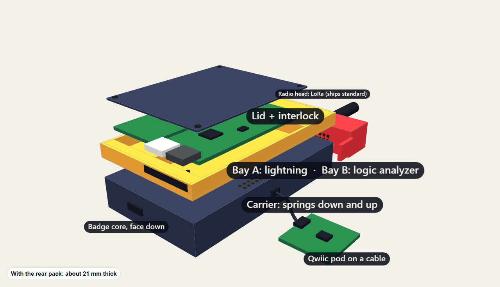

# Chord

An open-source, modular pocket multi-tool that doubles as the CTRL+A member badge.

> **Status: design phase.** There's no hardware, firmware or CAD yet. This repo holds the design docs for now. Board files, firmware and enclosures will land here as the club builds them.



## What it is

Every member gets a Chord, and it grows with them.

- **The core** is an ESP32-S31 board with:
  - Wi-Fi 6, Bluetooth and Thread/Zigbee
  - a display and 5-way navigation
  - an audio player with a headphone jack and speaker
  - microSD, USB-C and a rechargeable battery
- **Day one:** it does real work out of the box, as a mesh messenger, meeting check-in, music player and USB drive.
- **Advanced members:** it's a platform for PCB design, embedded firmware, RF and enclosure CAD.

The name comes from the CTRL+A chord mark: two keys pressed together, a core plus whatever you plug into it.

## How it expands

| Attachment | What goes there | Required? |
|---|---|---|
| **Radio head** (top) | Every external radio. A LoRa head ships with every badge; others swap in seconds | Yes |
| **Rear pack** (back) | A carrier with two bays for receive-only modules and one wired tool | No, opt-in |
| **Qwiic pods** (side) | Off-the-shelf I2C sensors, knobs and keypads on cables | No |
| **Power cover** (back) | Qi charging, solar or an extra battery | No |
| **Dock** (desk) | Big, hot or power-hungry gear, plus mikroBUS, SAO, Grove, Feather and Pmod sockets | Club-owned |

**Size:** 55 × ~113 × 15 mm with the radio head, or about 21 mm thick with the rear pack. The original spec's stacked boards would have reached 25–49 mm; [here's why that was dropped](docs/expansion-system.md#10-why-not-stacking).

## Docs

| Doc | What's in it |
|---|---|
| [Design decisions](docs/design-decisions.md) | Core hardware, RF rules, security and responsible use, firmware, timeline, cost, team |
| [Expansion system](docs/expansion-system.md) | Radio head, rear pack and bays, pods, covers, dock, contact maps, power and pin budgets, how many modules fit |
| [Parts catalog](docs/parts-catalog.md) | 222 candidate parts and modules, tagged by where each one plugs in |
| [Module interface](docs/module-interface.md) | Pin-by-pin and mm-by-mm detail for anyone designing a module or radio head |
| [Board plan](docs/board-plan.md) | Dev board → Rev A → Rev B → production, and what goes on the core board |

## Planning

The [planning folder](planning/) holds the club's working files: the [semester plan](planning/semester-0-plan.md), the [decision log](planning/decisions.md), the [team sheet](planning/team.md) and the [Rev A bring-up checklist](planning/rev-a-bring-up.md). They're meant to be filled in and changed as the project moves.

**Templates:**
- Propose a module with the *Module proposal* issue template.
- Propose a change to anything already decided with the *Design change* template.
- Every pull request gets a short checklist automatically.

## Roadmap

| When | What |
|---|---|
| Mid-Dec 2026 | Go/no-go on the ESP32-S31: published FCC grant, modules in stock, dev board proven |
| Spring 2027 | Build on dev boards. Beginners write apps; advanced members design and bring up Rev A |
| Summer 2027 | Rev B; design freeze about six weeks before the fall build |
| Fall 2027 | Every member gets a Chord with the LoRa head |
| 2028 | Rear pack, more heads, and member-designed modules through monthly KiCad sprints |

## Planned layout

```
hardware/     KiCad: core board, carrier, radio heads, bay modules
firmware/     ESP-IDF platform and apps
mechanical/   CAD, STEP and print files
docs/         design docs and images
```

## Licensing

Proposed, but not adopted yet:
- CERN-OHL-W-2.0 for hardware
- Apache-2.0 for firmware
- CC-BY-SA-4.0 for docs and CAD

License files will be added once the club confirms them.

## Responsible use

Chord includes tools for radio, RFID/NFC and hardware security work. They're for club-owned equipment, blank tags and coursework only:
- Never clone or emulate a credential you aren't authorized to hold.
- Wi-Fi capture is passive only.
- Transmit, emulation and fault-injection hardware is club-owned, loan-only, and requires the club's acceptable-use policy and training.
