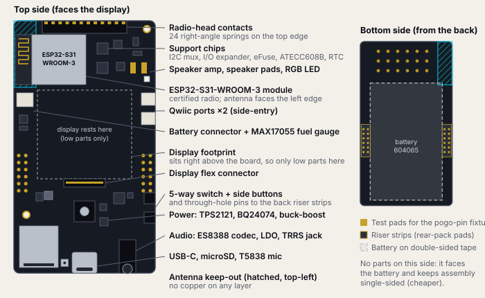
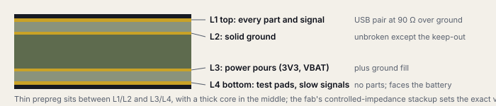
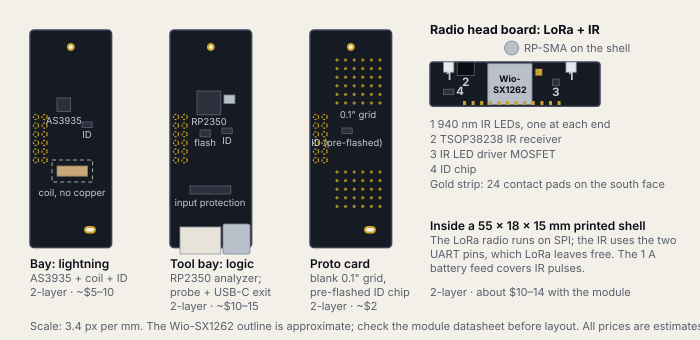

# Chord: Board Plan

**Draft, Nov 2026.** This is how the club gets from a store-bought dev board to its own badge. The layouts are concept placements, not routed designs, and the costs are estimates.

## Stages

| Stage | When | What | Qty | Est. cost each | Done when |
|---|---|---|---|---|---|
| **Dev boards** | Spring 2027, weeks 1–8 | ESP32-S31 dev board + breakouts (display, codec, microSD, LoRa, Qwiic) on a breadboard | 10+ | $20–60 | A2DP, high-speed USB, SDMMC, display, codec and LoRa all work on a pinned ESP-IDF 6.1.x |
| **Rev A: bring-up board** | Weeks 9–14 | Our first PCB: bigger, easy to probe | 5–10 assembled | $60–100 | Every rail measured, every subsystem works, fix list written ([checklist](../planning/rev-a-bring-up.md)) |
| **Rev B: pocket board** | Summer 2027 | Final 51 × 91 mm, 4-layer, everything on the top side | 10–20 | $80–95 with battery and case | Fits the shell, passes the test fixture, runtime measured per mode |
| **Production** | Fall 2027 | Rev B + fixes, ordered to paid deposits | ~200 | $40–48 core + ~$10–14 LoRa/IR head | Every member has one |

## Module, dev kit or bare chip?

| Option | What it is | Our use |
|---|---|---|
| Dev kit | Espressif's module on a generic breakout | Only for weeks 1–8, so firmware can start before our hardware exists |
| **Module on our board** | The same ~$5–7 certified ESP32-S31-WROOM-3 module, soldered onto our PCB with our own power, audio, display and connectors | **Rev A onward, including production** |
| Bare chip ("chip-down") | The S31 chip itself, with our own RF, PSRAM and USB layout | Possible later as a learning board. Never for boards we hand out, because it needs our own FCC certification (roughly $10–30k per radio) |

## Core board contents (suggested parts)

| Block | Part(s) | Notes |
|---|---|---|
| MCU | ESP32-S31-WROOM-3 | Antenna at the top-left edge, keep-out on every layer |
| Charging | BQ24074 + TPS2121 | USB-C wins over cover input |
| 3V3 | TPS63802 (or TPS63020) buck-boost | Push-button controller with long-press hard-off |
| Fuel gauge | MAX17055 + sense resistor | Per-app current |
| Audio | ES8388 + NS4150B + low-noise LDO, TRRS jack, speaker pads | Dedicated analog supply |
| Mic | TDK T5838 | Wake-on-sound |
| Storage | microSD on 4-bit SDMMC | |
| Display | **Open:** 1.3" mono OLED or 1.47" colour IPS, on its own SPI bus + flex connector | Decide before the Rev A schematic |
| Security | ATECC608B on a private bus | |
| Expansion | TCA9548A mux, I/O expander, eFuses per port, CIPO buffers, analog switch for Qwiic 2 | See [module interface](module-interface.md) |
| Connectors | Head spring connector (top edge), 2 × Qwiic, riser-strip pins, USB-C | |
| Misc | RV-3028 RTC, WS2812B-2020 LED, 5-way switch + 2 side buttons | Buy the 5-way switch early |

**Layout rules**
- Every part on the top side. The bottom faces the battery and carries only test pads.
- Only low parts under the display footprint.
- Keep the antenna keep-out clear on all layers.
- The head connector sits on the top edge.
- The riser strips carry the back pads up beside the battery.

## Rev A: make it easy to debug

- **Bigger board** (about 80 × 120 mm). Same circuits, room to probe.
- **Isolate and measure every rail:** 0 Ω links or solder jumpers on each rail, plus a current-sense shunt and a test point on each.
- **A status LED** on each rail.
- **Footprints for both display options,** if the decision isn't made yet.
- **Bay and head signals** also broken out to 2.54 mm headers, so modules can be prototyped on a breadboard.
- **Debug access:** USB-Serial-JTAG on the USB-C, plus pads for an external probe.
- **Silkscreen:** a label on every test point, with its expected voltage.

## Stackup (4 layers, 1.6 mm)

## Module and head boards

These are small 2-layer boards and good first KiCad projects. They can be designed while the core board is still in progress.

## Fill in as you go

| Item | Value | Owner | Date |
|---|---|---|---|
| Display chosen | | | |
| Rev A board size | | | |
| Rev A fab + assembler | | | |
| Rev A order date | | | |
| Rev B board revision notes | | | |
