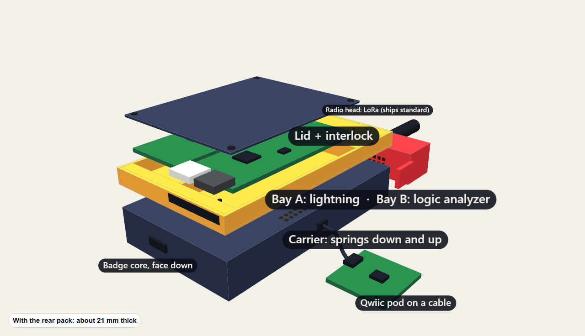
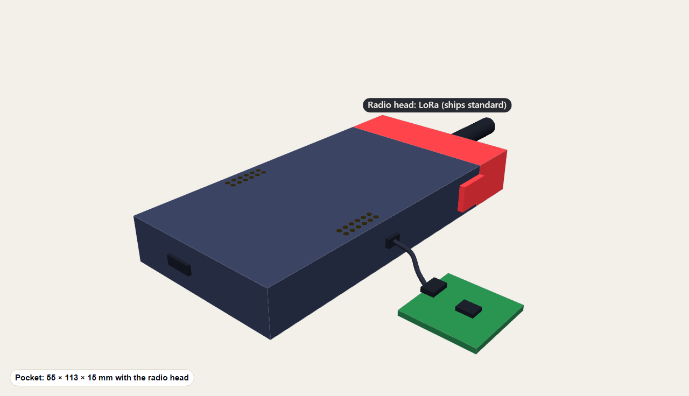

# Chord: Expansion System

**Draft v0.2, 26 Nov 2026.** This is concept-level: there is no CAD and no schematic yet, and nothing has been ordered. Dimensions come from the design panel's numbers or are estimates, and estimates are marked.

- **Where it comes from:** the design panel's ratified module interface (CMI v0.1). On top of that are the radio-first changes requested afterwards, which the panel has **not** reviewed yet. They're marked **[v0.2]** and listed in [section 13](#13-changes-from-the-panels-cmi-v01).
- **Related:** [design decisions](design-decisions.md) for the rest of the badge, and the [parts catalog](parts-catalog.md) for every candidate module.



---

## 1. What we're doing instead of stacking

The original spec stacked 2–4 boards on the back using 2.54 mm headers and 8 mm spacer rings. That's dropped (see [section 10](#10-why-not-stacking)). Instead, the badge has **five ways to add things**, each built for one job:

```
              ┌────────────────┐
              │   RADIO HEAD   │  top end · always fitted · swaps in seconds
              ├────────────────┤
              │                │
   Qwiic ◄────┤   BADGE CORE   │  55 × 95 × 15 mm: display, ESP32-S31, battery
   pods       │                │
              │                │
              └───────┬────────┘
                      │ USB-C
 back:  REAR PACK (optional, about +6 mm): carrier with 2 bays → bay modules
        └─ POWER COVER (optional): Qi, solar or extra battery
 desk:  DOCK: mikroBUS, SAO, Grove, Feather, Pmod, big tools
```

| Attachment | What goes there | Required? |
|---|---|---|
| **Radio head** (top) | Every external radio: LoRa ships standard | **Yes.** Every badge has one **[v0.2]** |
| **Rear pack** (back) | Two bays for receive-only modules and one wired tool | No, opt-in |
| **Qwiic pods** (side) | Off-the-shelf I2C sensors, knobs and keypads on cables | No |
| **Power cover** (back) | Qi charging, solar or an extra battery | No |
| **Dock** (desk) | Big, hot, power-hungry or uncertified gear | Club-owned |

## 2. Sizes

| Setup | W × L × T | Notes |
|---|---|---|
| Badge core alone | 55 × 95 × 15 mm | Meets the spec's 14–18 mm target |
| **Pocket setup:** core + radio head | 55 × ~113 × 15 mm | The head adds length, never thickness. SMA heads add an antenna stub of about 30 mm |
| + rear pack | 55 × ~113 × ~21 mm | Pack is about 6 mm |
| + rear pack + Qi cover | ~23.5 mm thick | Cover about 2.5 mm (estimate) |
| Old spec, 1 / 2 / 4 stacked boards | ~25 / ~33 / ~49 mm thick | Why stacking was dropped |
| For scale: phone / Flipper Zero | ~8 mm / ~25 mm thick | |



## 3. Radio head (top attachment) [v0.2]

The radio is required, and it lives on the top so it can be swapped easily.

**Why the top:**
- Antennas need to be clear of the battery and away from the hand.
- The radio is what members swap most.
- Keeping every external transmitter in one place makes the FCC and co-location rules simple to enforce.

**Mechanics**
- The head **pushes straight onto the top end** along the badge's length. Two dovetail arms run about 12 mm down the badge's sides, and a steel ball-plunger detent clicks it home. Pull to remove; whether to add a release button is still open.
- **Contacts:**
  - 24 spring pins sit on the badge's top end face (2 rows × 12, 2.54 mm pitch). Flat gold (ENIG) pads sit on the head's mating face.
  - The springs compress along their own axis at the end of travel, so nothing slides across the pads.
  - The ground springs are longest, so they mate first. DET is shortest, so it mates last and breaks first, which makes hot-swapping safe.
- **Envelope:** 55 × 18 × 15 mm, flush with the badge. The inside is roughly 50 × 14 × 12 mm (estimate). Antennas leave through the top end.
- **Different shape from bay modules:** a head can't go into a bay and a bay module can't go onto the top. This settles the panel's unresolved "one outline, two homes" problem.

**Head lineup**

| Head | Radio | FCC status (verify on fccid.io) | Antenna | Access |
|---|---|---|---|---|
| **LoRa** (ships with every badge) | Seeed Wio-SX1262, 915 MHz, driven over SPI with RadioLib | FCC Z4T-WIO-SX1262 | RP-SMA stub | Everyone. Region-locked US915 Meshtastic **[v0.2, needs sign-off]** |
| **LoRa + GNSS** | Wio-SX1262 + u-blox M10 with a patch antenna on the head's back face | LoRa as above. GNSS is receive-only | RP-SMA + patch | Everyone |
| **Pocket LoRa** | Wio-SX1262, flush | Only if an internal antenna of that type is listed in the module's grant | Internal | Everyone |
| **Standalone Meshtastic** | RAK4631, or XIAO ESP32S3 + Wio-SX1262 running stock Meshtastic, talking over UART | Check each one's ID | RP-SMA | Everyone. Fallback if the S31 Meshtastic port slips |
| **Listener** | Si4732 AM/FM/SW; audio goes to RADIO_IN and out the headphone jack | Receive-only | Telescopic rod | Everyone |
| **5 GHz Wi-Fi scanner** | ESP32-C5-MINI-1, monitor mode by default | Espressif publishes a 5 GHz FCC cert | RP-SMA | LAB |
| **Sub-GHz lab** | TTM A1101R09C (CC1101, 915 MHz), ships receive-only | FCC X7J-A10040601 | RP-SMA | LAB |
| **UWB** | Qorvo DWM3001C | FCC/ISED listed | Internal | LAB |

**Not allowed as a head:**
- Anything whose grant assumes 20 cm from the body, such as 1 W LoRa (Wio-SX1262-1W) or nRF9151 cellular.
- Uncertified radio boards, such as generic 315/433 MHz CC1101 boards or the E22-900M22S.

These live on the dock as club-owned lab kits.

**Rules**
- One external transmitter is active at a time. A firmware radio arbiter enforces this.
- Every transmitting head declares a TX flag and its FCC ID in its manifest. Ship only antennas of the type and gain the module's grant lists, and use RP-SMA.
- With no head fitted, the badge still runs: its own Wi-Fi, Bluetooth and 802.15.4 keep working, and radio apps pause with a "No radio head" notice.

**Head contacts (24 pads)**

| Pad | Signal | Notes |
|---|---|---|
| H1–H4 | GND ×4 | H1–H2 on long springs, so they mate first |
| H5 | 3V3_SW | ≤300 mA, eFuse on the badge |
| H6–H7 | VBAT_SW ×2 | 1 A peak / 0.5 A average, doubled contact |
| H8–H9 | ID_SDA, ID_SCL | The head's own I2C mux channel; ID EEPROM at 0x50 |
| H10–H13 | SCK, COPI, CIPO, CS | Shared SPI; CIPO is buffered and high-Z until enabled |
| H14 | IRQ | e.g. SX1262 DIO1 |
| H15 | BUSY / IO | e.g. SX1262 BUSY |
| H16 | RESET | Driven from the I/O expander |
| H17–H18 | UART TX, RX | For heads with their own processor |
| H19 | RADIO_IN | Into the codec line input, placed beside a GND pad |
| H20 | DET | Shortest spring: mates last, breaks first |
| H21–H24 | Reserved | Candidates: USB D+/D− in a later revision |

Compared with the panel's rail, CAN TX/RX and VIN_EXT come off the top, and BUSY and RESET go on, because driving a LoRa chip directly needs them. **[v0.2]**

## 4. Rear pack: carrier and two bays





**The pack**
- It's opt-in. The carrier replaces the flat back cover and adds about 6 mm.
- The carrier holds springs both ways: down onto flat gold pad fields on the badge's back, and up into each bay. Members buy the springs once. Modules are plain boards, about **$1.45 each empty at 100 units**.
- **Two bays**, each 24 × 64 mm, side by side.
  - Bay B is Bay A turned 180°, so any module fits either bay.
  - Both bays stop at least 25 mm short of the top end, which keeps the antenna keep-out clear.
- **Contacts:**
  - The 12 springs for each bay sit over the roughly 6 mm strip beside the battery. Spring and screw force go into the case walls, never the battery pouch.
  - A 1 mm swell gap stays above the cell.
- **Two steel dowels per bay**, one of them offset. A module turned the wrong way can't seat; without this it would put VBAT onto CIPO.
- **Lid:** screwed on. An interlock spring (one GPIO for the whole carrier) cuts power to both bays before the module contacts let go.
- **Bays are receive-only.** They sit on the battery, against your body, so transmitters never go there.

**What fits on a bay module**
- Board area: 24 × 64 mm, about 15 cm².
- Part height: about **2.5 mm maximum** above the board (estimate; the mechanical spec still has to set it).
- Too tall or too wide for a bay: ceramic patch antennas (which go in a head), Geiger tubes and the 1.54" e-ink panel (which go on the dock or a pod).

**Tool bay [v0.2]**
- **Wired tools** move here from the old rail: CAN, RS-485, the logic analyzer, level shifters and field I/O.
- A tool module puts a low-profile connector (≈3 mm class, possibly sunk into a board cutout; verify) at its south end. The connector exits through a slot in the carrier's bottom wall, beside the badge's USB-C, so **the radio head stays on while you use wired tools.**
- **Only Bay B has an open end at the bottom wall,** so wired tools go in Bay B and only one runs at a time. Bay A takes sensor modules.
- **UART or CAN in a bay:** pads 11 (IRQ) and 12 (IO) go through the S31's GPIO matrix, so a bay module can use them as UART TX/RX or CAN TX/RX instead. Verify that CAN (TWAI) routing works this way on the S31.
  - The S31 has one CAN controller. A second bus needs an MCP2518FD over SPI.
  - CAN transceivers must run from 3.3 V: use the TCAN3413, not the 5 V-only TCAN1462.

**Bay contacts (12 pads, 2 × 6 at 2.54 mm, 1.6 mm pads)**

| Pad | Signal | Notes |
|---|---|---|
| 1, 2 | GND | Long springs, so they mate first |
| 3 | 3V3_SW | ≤100 mA. On while idle so the ID chip can be polled |
| 4 | VBAT_SW | ≤300 mA. Off until the ID is read and policy allows it |
| 5, 6 | SDA, SCL | The bay's own mux channel. ID EEPROM at 0x50 plus the module's own I2C parts |
| 7, 8, 9 | SCK, COPI, CIPO | Shared SPI. CIPO is buffered and high-Z until enabled |
| 10 | CS | Direct S31 pin |
| 11 | IRQ, or UART RX / CAN RX | Direct, through the GPIO matrix |
| 12 | IO, or UART TX / CAN TX | Direct. High-Z until policy allows it |

A Rows 1–6 / 7–12 layout means a rotated module would land pad *n* on pad 13−*n*. The offset dowel exists to prevent that.

**Later:** a 4-bay carrier, sensor-class only, with its own I/O expander. It shares the same power pool.

## 5. Qwiic pods

- **Ports:** two, each on its own mux channel. Port 2 can be remapped to UART or PDM in firmware.
- **Power:** 200 mA shared between both ports.
- **No soldering:** hundreds of off-the-shelf boards work.
- **Detection:** by I2C address plus a chip-ID register, since pods have no ID EEPROM.
- **Address clashes to avoid on one channel:**
  - VL53L4CD and VL53L5CX (0x29)
  - AS7341 and APDS9960 (0x39)
  - VEML7700 and PA1010D (0x10)
  - LTR390 (0x53) sits in the ID range. That's harmless here, because ID chips live on their own channels.
- **Starter:** pick two for **$20 or less**. The default pair is the VL53L4CD distance sensor + LTR390 UV/light sensor ($19.90).

## 6. Power covers

| Cover | Parts | What it does |
|---|---|---|
| Qi | BQ51013B or P9222-R + coil + ferrite sheet | Charges on a 5 W-class pad |
| Solar | 6 V panel straight into VIN_EXT | 0.3–0.5 W in full sun |
| Booster | BQ25895 + 403450 protected cell | Roughly +40% runtime; has its own USB-C |

- **How they connect:** covers plug into **two VIN_EXT pads** on the back. When the pack is fitted, it passes those pads through to its own back face, so covers and bays work together.
- **Inside the badge:** a TPS2121 mux picks the source and USB-C wins. The BQ24074 stays the only charger of the main cell, and a second cell never connects to VBAT.

## 7. Dock (desk)

The dock takes anything not meant for a pocket:
- **Sockets:** mikroBUS (about 2,000 Click boards), SAO, Grove, Feather and Pmod.
- **Power-hungry or large gear:** USB-PD bench supply, electronic load, thermal camera, particle sensors with fans.
- **Radios not allowed on the badge:** uncertified lab radios, cellular, satellite, 1 W LoRa repeaters, RTL-SDR.

**Stacking boards is fine on the dock,** because thickness doesn't matter there.

## 8. Capacity: how much can be attached

**At the same time, in a pocket**

| Where | Max at once | What limits it |
|---|---|---|
| Radio head | 1 (always fitted) | One external transmitter; FCC co-location |
| Rear bays | 2 (4 with a later sensor-only carrier) | Spare GPIOs; 100 mA of 3V3 per bay |
| Wired tools | 1 (in Bay B) | Only Bay B opens onto the bottom wall |
| Qwiic pods | 2 ports, chainable; in practice about 4–6 small sensors | 200 mA shared, and I2C address clashes (a mux pod adds 8 channels) |
| Power cover | 1 | One back face |

**A typical maximum pocket build:** 1 radio head + 2 bay modules + about 4 pods + 1 power cover, about 8 attachments.

**Power pool (shared by every expansion)**

| Rail | Head | Each bay | Qwiic (shared) | Pool |
|---|---|---|---|---|
| 3V3 | 300 mA | 100 mA | 200 mA | 800 mA (700 allocated, 100 spare) |
| VBAT | 1 A peak / 0.5 A average | 300 mA | n/a | 1.2 A peak |

- Each module declares its peak current in its manifest, and the badge refuses any module that would overflow the pool.
- The UI shows live draw per port, measured by a MAX17055 fuel gauge.
- Every 100 mA of continuous load roughly halves the ~15 h Bluetooth-audio runtime.

**Pin budget (direct ESP32-S31 GPIOs)**

| Use | Pins |
|---|---|
| Bays: CS, IRQ, IO × 2 | 6 |
| Head: CS, IRQ, BUSY/IO, DET, UART TX/RX | 6 |
| Shared SPI | 3 |
| Qwiic port 2 remap | 2 |
| Lid interlock | 1 |
| **Total** | **18** of ~22 spare |

- The head's RESET, every power-switch enable and the CIPO buffer enables move to the I2C I/O expander, which has hardware pull-downs so power stays off at reset.
- The budget only fits if the buttons also move to that expander.
- The panel's v0.1 used 19 pins; v0.2 frees one because CAN left the top.

## 9. Is it as modular as the original spec?

| | Original spec | This design |
|---|---|---|
| Rear expansion | 2–4 boards stacked on 2.54 mm headers + 8 mm rings | 2 bays in one carrier (4 later, sensor-only) |
| Thickness with rear expansion | ~25 mm (1 board) to ~49 mm (4) | ~21 mm |
| Swapping one module | Remove everything stacked above it | Open the lid and swap just that one |
| Connector life | ~25–100 plug-ins (tin headers) | ~1 million (spring pins on gold pads) |
| Top attachment | Quick-swap rail with SMA, OBD or logic-analyzer caps | Radio head, always fitted, swappable |
| Wired tools | Top-rail caps | Tool bay with a bottom-wall exit; the radio stays on |
| Off-the-shelf parts | Qwiic only | Qwiic pods + a dock with mikroBUS, SAO, Grove, Feather and Pmod |
| Cost of a new module | Board + stacking headers | About $1.45 empty at 100 |
| Auto-detect | EEPROMs at 0x50–0x57 that collide when stacked | ID chip on its own mux channel, with a power budget and a prompt before enabling |
| Transmitters | Anywhere | Radio head only, one at a time |

**Bottom line:**
- **Fewer slots:** you get fewer rear slots at once (2 instead of up to 4).
- **Better slots:**
  - every slot is usable in practice
  - each module swaps on its own
  - the badge stays pocketable
  - the radio slot, pods, covers and dock add more ways to grow than the spec had

## 10. Why not stacking



Stacking works on a desk (Pi HATs, Feathers). It fails on a badge meant to sit in a pocket next to a phone:

1. **Thickness.** Each board adds a mated header (about 8.5 mm) plus the board, so the target is broken with the first board: about 25 mm. Four boards come to about 49 mm.
2. **It sits on the battery.** The spec's 50 × 60 mm bay lies over the 40 × 65 mm cell. The headers could only go in the 6–7 mm strips beside it, with pin tails pointing at a pouch that swells and can be punctured.
3. **The connectors wear out.** Tin stacking headers last roughly 25–100 plug-ins and wobble once stacked.
4. **The signals degrade.** Fast SPI through 2–4 header joints means long stubs with no ground beside each signal, and hot-plugging browns out the badge.
5. **Addresses and pins run out.** Identical boards in a stack answer at the same address, and the S31 has about 22 spare pins, not enough for a deep stack.
6. **The radio suffers.** A tower of ground planes and metal beside the antenna detunes it, and any transmitter in the stack sits on top of the main radio and against your body.
7. **It breaks when dropped.** A tall stack acts as a lever on its header solder joints.

## 11. Firmware behaviour

- **Detection:**
  - Bays are checked once a second for an ID chip answering at 0x50 on their own mux channel.
  - The head and the lid interlock raise interrupts.
  - Pods are found by address and chip-ID probing.
- **Never powers anything by itself:** when a new module appears, the badge asks "Module found: …, enable?".
- **Admission:** after you say yes, the badge checks the CRC, the power budget, the transmitter rule and the LAB flag. It then switches on 3V3, then VBAT, and binds the driver by name.
- **Manifest:**
  - A 32-byte `CTRA` header: schema, VID/PID, revision, serial and CRC.
  - Fields for the logical pin map, peak mA per rail, driver name, TX flag + FCC ID, LAB flag, and app IDs.
  - Unsigned. Code stored on a module **never runs by itself**.
- **Unknown module:** the badge shows a QR code linking to its catalog page.
- **Radio arbiter:** one external transmitter at a time. VBAT reaches a transmitter only when it's on the top.
- **LAB flag:** it prevents accidents and records intent; it is not enforcement. The real controls are that LAB hardware is club-owned and loan-only, PCB credits for LAB designs need a design review, and members sign the AUP and complete training.

## 12. Example builds

| Build | Radio head | Bay A | Bay B | Pods | Thickness |
|---|---|---|---|---|---|
| **Day one** | LoRa | – | – | VL53L4CD + LTR390 | 15 mm |
| **Field mapper** | LoRa + GNSS | AS3935 lightning sensor | Free | – | ~21 mm |
| **Bench debugger** | LoRa (stays on) | SE050 secure-element lab | RP2350 logic analyzer: probes + USB-C out the bottom | INA228 power meter | ~21 mm |
| **Car night** (LAB) | LoRa (stays on) | Free | Auto tool module: CAN FD on pads 11–12 plus LIN/K-line through an SPI UART bridge; OBD cable out the bottom | – | ~21 mm |
| **Listener** | Si4732 AM/FM/SW | – | – | Rotary encoder for tuning | 15 mm |

The renders show LoRa + lightning in Bay A + logic analyzer in Bay B + one pod.

## 13. Changes from the panel's CMI v0.1

These follow from the radio-first requirement and **need panel review**:

1. **The top becomes the radio head.** It's radio-only and always fitted, and the LoRa head ships with every badge.
   - That adds about **$10–12 per badge** (estimate: $5.95 module + shell, RP-SMA and antenna). It affects the $40 deposit.
   - In the panel's plan, LoRa was an earned upgrade after RF training. Program, RF and Security need to agree it can ship to everyone, region-locked.
2. **The head pushes straight on along the badge's length.** Springs sit on the badge's top end face, so nothing slides across them.
3. **Head contacts change.** CAN TX/RX and VIN_EXT leave the top; BUSY and RESET join; 4 pads are reserved.
4. **Wired tools move from the rail to Bay B.** Bay B becomes the tool bay, with a bottom-wall exit and one wired tool at a time.
5. **Bay pads 11–12 can carry UART or CAN** through the GPIO matrix.
6. **GNSS with a patch antenna moves into a head,** because the bay height budget is too small.
7. **Bay modules and heads are separate shapes.** This fixes the unresolved "one outline, two homes" issue.
8. **Pin budget:** 18 direct GPIOs instead of 19.

## 14. Open questions and next steps

**Open**
- **Height:** what is the part-height budget inside the pack (estimate 2.5 mm), and can a ≈3 mm tool connector fit?
- **CAN routing:** can the S31 route CAN (TWAI) and UART onto bay pads 11–12? Check the S31 datasheet.
- **FCC:**
  - The S31 module's own grant (none found yet).
  - The Wio-SX1262 grant's antenna list and RF-exposure conditions for handheld use.
  - Whether an internal antenna is allowed for the pocket head.
- **NFC readers** transmit at 13.56 MHz under §15.225. Do they count as heads?
- **Head release:** detent only, or a button?
- **Antenna:** the badge's own antenna sits in the top-left keep-out, near the head. Confirm the separation with the head's antenna.
- **Cost:** a standard LoRa head versus the $20 starter cap and the $40 deposit.

**Next steps**
1. Panel review of the v0.2 changes in section 13.
2. Mechanical interface document v0.2: datums, height budget per zone, pad coordinates, dowel positions, the head dovetail.
3. Test prints of the carrier, a blank bay module and a head shell, on club printers or in MJF nylon.
4. Bring up the ESP32-S31 dev boards: LoRa over SPI with RadioLib, the bay ID polling loop, and power admission.
5. Mid-December 2026 go/no-go on the S31: published FCC grant, 100+ modules quoted, and a dev board showing A2DP, HS-USB and SDMMC working on a pinned ESP-IDF 6.1.x.

## 15. Files

| File | What it is |
|---|---|
| `docs/expansion-system.md` | This document |
| `docs/design-decisions.md` | Everything else the design review decided |
| `docs/parts-catalog.md` | Candidate parts and modules, tagged by where they fit |
| `docs/images/` | Renders and scale drawings used in these docs |
