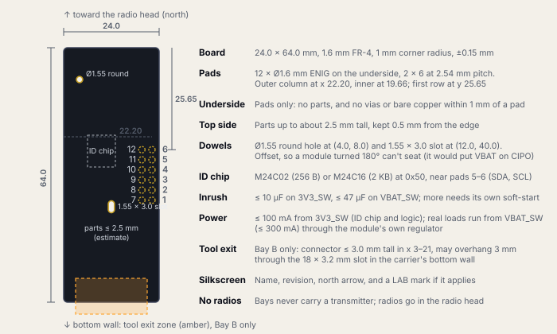
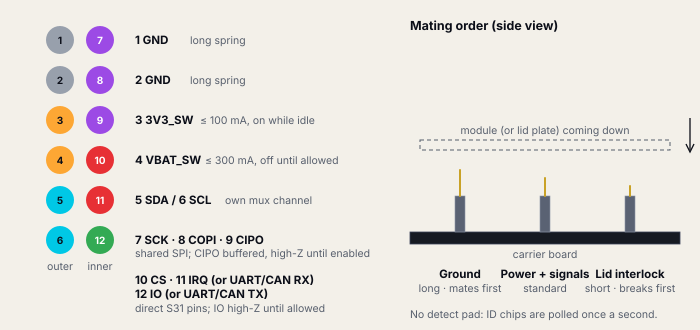
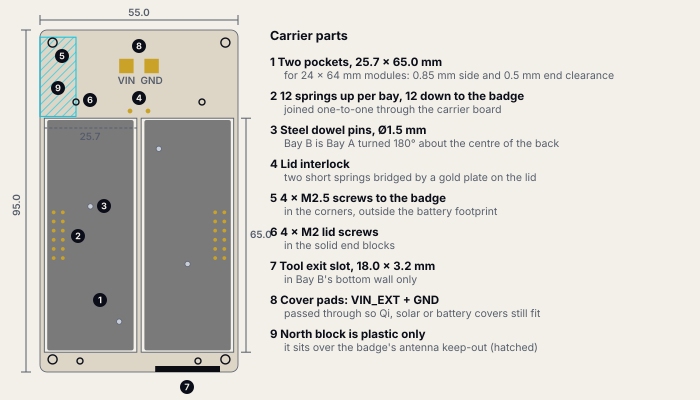
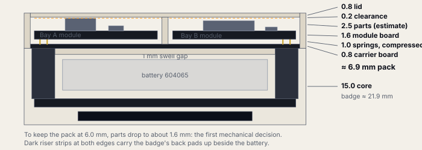
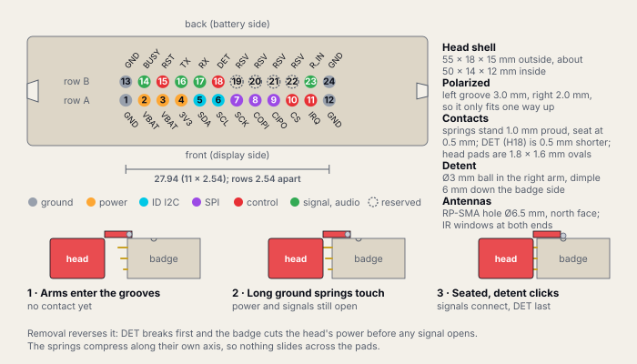
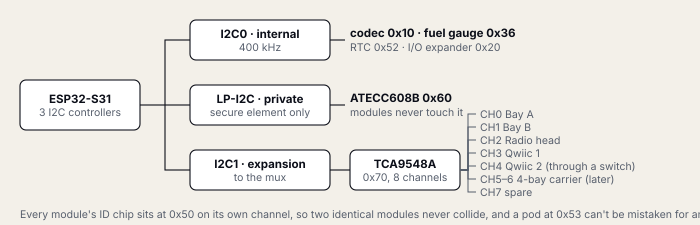
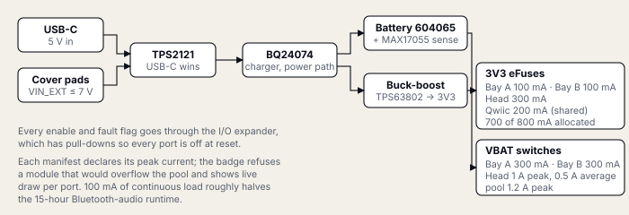
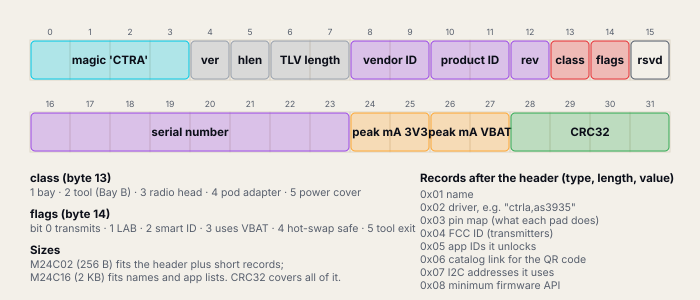
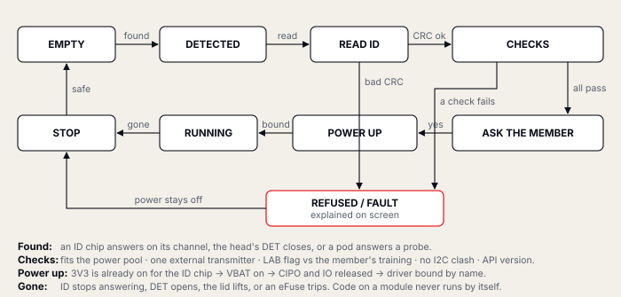
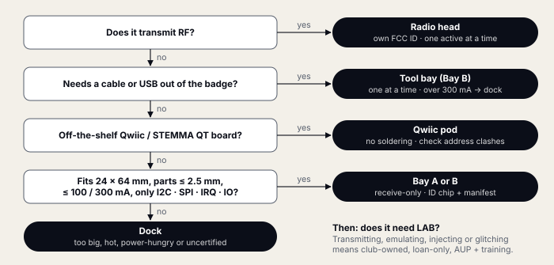

# Chord: Module Interface Spec (CMI v0.2 detail)

**Draft, 26 Nov 2026.** This builds out the [expansion system](expansion-system.md) to the level someone needs to design a module.
- Dimensions are in mm. Coordinates are measured from a part's top-left corner in top view.
- Values marked *(est.)* need a test print or datasheet check.
- Related: [expansion system](expansion-system.md) (the overview), [board plan](board-plan.md), [parts catalog](parts-catalog.md).
- **Status:** a starting point for the club to change through design-change issues, not a frozen spec.

---

## 1. The five ports

| Port | Where | Count at once | For |
|---|---|---|---|
| Radio head | Top end | 1, always fitted | Every external radio, plus IR |
| Bay A / Bay B | Rear pack | 2 | Receive-only modules. Bay B also carries one wired tool |
| Qwiic 1 / Qwiic 2 | Side | 2 ports, chainable | Off-the-shelf I2C boards |
| Power cover | Back | 1 | Qi, solar, extra battery |
| Dock | Desk | — | Everything else |

## 2. Bay module

### 2.1 Outline and board
| Item | Value |
|---|---|
| Size | 24.0 × 64.0 mm, 1 mm corner radius, ±0.15 mm |
| Board | 1.6 mm FR-4, 2-layer is enough for most modules. ENIG finish (required for the pads) |
| Underside | Pads only: no parts, and no vias or bare copper within 1 mm of a pad |
| Top side | Parts up to **2.5 mm** tall *(est.)*, kept 0.5 mm from the edge |
| Reference orientation | As fitted in Bay B: the exit end faces the badge's bottom wall |

### 2.2 Pads (underside, Bay B frame)

- 12 × Ø1.6 mm ENIG pads, 2 columns × 6 rows, 2.54 mm pitch.
- Outer column at x 22.20, inner column at x 19.66.
- Rows at y 25.65, 28.19, 30.73, 33.27, 35.81 and 38.35.
- In Bay A orientation (north up, outer column on the left), pads run 1–6 down the outer column and 7–12 down the inner column. Turning the module 180° maps pad *n* onto pad 13 − *n*.

| Pad | Signal | Limit / note |
|---|---|---|
| 1, 2 | GND | Long springs: they mate first |
| 3 | 3V3_SW | ≤ 100 mA. On while the bay is idle, so the ID chip can be polled |
| 4 | VBAT_SW | ≤ 300 mA (3.0–4.2 V). Off until the ID is read and policy allows it |
| 5, 6 | SDA, SCL | The bay's own mux channel, 400 kHz. ID chip at 0x50, plus the module's own I2C parts |
| 7, 8, 9 | SCK, COPI, CIPO | Shared SPI, ≤ 20 MHz. CIPO is buffered on the badge and high-Z until the bay is enabled |
| 10 | CS | Direct S31 pin, active low |
| 11 | IRQ | Direct S31 pin; active-low open drain, pulled up on the badge. **Alt:** UART RX or CAN RX |
| 12 | IO | Direct S31 pin; GPIO or ADC, high-Z until allowed. **Alt:** UART TX or CAN TX |

### 2.3 Dowels and keying
- Ø1.55 mm round hole at (4.0, 8.0), and a 1.55 × 3.0 mm slot at (12.0, 40.0) running along Y.
- They mate with Ø1.5 mm steel pins in the carrier.
- The positions are deliberately off-centre, so a module turned 180° can't seat. Turned, it would put VBAT onto CIPO.
- **[v0.2 detail]** Both dowels moved to keep clear of the tool exit zone. The earlier overview drawings show the old positions.

### 2.4 Zones
- **ID chip:** within about 15 mm of pads 5–6.
- **Tool exit (Bay B only):**
  - Connector zone x 3–21 at the exit end, parts ≤ 3.0 mm tall.
  - Connectors may overhang the edge by up to 3 mm through the carrier's 18 × 3.2 mm wall slot.
  - Use low-profile side-entry or mid-mount parts. Check their real heights against the budget in 3.2.

### 2.5 Electrical rules
- **Inrush:** ≤ 10 µF on 3V3_SW and ≤ 47 µF on VBAT_SW. More needs the module's own soft-start.
- **Loads:** anything over the 3V3 budget runs from VBAT_SW through the module's own regulator.
- **Logic levels:** 3.3 V only. Anything 5 V needs level shifting on the module.
- **Protection:** the badge has TVS diodes and 33 Ω series resistors. Modules that face the outside world (tool bay) add their own protection.
- **No transmitters.** Ever.

## 3. Rear pack (carrier)

### 3.1 Carrier
| Item | Value |
|---|---|
| Footprint | 55 × 95 mm; replaces the flat back cover |
| Pockets | 25.7 × 65.0 mm each, so modules get 0.85 mm side and 0.5 mm end clearance |
| Walls / divider | 1.2 mm |
| Carrier board | Passive 2-layer ENIG board. 12 springs down to the badge and 12 up to the module per bay, joined one-to-one |
| Springs | Mill-Max 0906/0907 class, rated about 1M cycles, 2 A. Grounds use a longer spring |
| Dowel pins | Ø1.5 mm steel. Bay B is Bay A turned 180° about the centre of the back |
| Fixing | 4 × M2.5 screws to the badge, in the corners outside the battery footprint. 4 × M2 lid screws in the end blocks |
| Lid interlock | Two short springs bridged by a gold plate on the lid; one GPIO (LID_DET). Lid off means both bays off |
| Tool exit | 18.0 × 3.2 mm slot in Bay B's bottom wall |
| Cover pass-through | VIN_EXT + GND pads on the north block, so covers still fit |
| North block | Solid plastic, because it sits over the badge's antenna keep-out |

### 3.2 Height budget *(est.)*

| Layer | mm |
|---|---|
| Carrier board | 0.8 |
| Springs, compressed | 1.0 |
| Module board | 1.6 |
| Module parts | 2.5 |
| Clearance | 0.2 |
| Lid | 0.8 |
| **Pack** | **≈ 6.9** |

- With the pack, the badge is about 21.9 mm thick (15.0 mm core).
- Holding the pack to 6.0 mm drops the part limit to about 1.6 mm.

### 3.3 Badge back pads (under the carrier)
| Group | Pads |
|---|---|
| Field A | 12, on the left riser strip, matching Bay A |
| Field B | 12, on the right riser strip, matching Bay B |
| LID_DET | 1 |
| Cover pads | 2: VIN_EXT and GND |

These are flat ENIG pads on riser strips that sit beside the battery. They're connected to the main board by through-hole pins, which members solder at the build night.

## 4. Radio head

### 4.1 Mechanics
| Item | Value |
|---|---|
| Envelope | 55 × 18 × 15 mm outside, about 50 × 14 × 12 mm inside *(est.)* |
| Mating | Pushes straight onto the top end along the badge's length. Springs compress along their own axis, so nothing slides across the pads |
| Guides | Two dovetail arms 12 mm long. Left groove 3.0 mm, right groove 2.0 mm, so it's polarized and fits one way up |
| Detent | Ø3 mm ball plunger in the right arm; dimple 6 mm down the badge side |
| Contacts | 24 springs on the badge's top end face; 1.8 × 1.6 mm oval pads on the head (±0.4 mm tolerance) |
| Spring heights | Standard springs stand 1.0 mm proud and seat at 0.5 mm. Grounds are longer; DET is 0.5 mm shorter |
| Openings | RP-SMA hole Ø6.5 mm on the north face; IR windows at both ends |

### 4.2 Head contacts (positional)
- Viewed facing the top end face, with the back of the badge at the top.
- Row A sits nearer the front at t = 6.23 mm; row B at t = 8.77 mm.
- Columns span 27.94 mm at 2.54 mm pitch, centred on the badge.
- **This order replaces the list that was in [expansion-system.md](expansion-system.md) §3.** The signals are the same; only the positions are fixed here.

| Row A | Signal | | Row B | Signal |
|---|---|---|---|---|
| H1 | GND (long) | | H13 | GND (long) |
| H2 | VBAT_SW | | H14 | BUSY / IO |
| H3 | VBAT_SW | | H15 | RESET (from the I/O expander) |
| H4 | 3V3_SW (≤ 300 mA) | | H16 | UART TX |
| H5 | ID SDA (CH2) | | H17 | UART RX |
| H6 | ID SCL | | H18 | DET (short) |
| H7 | SCK | | H19 | reserved |
| H8 | COPI | | H20 | reserved |
| H9 | CIPO | | H21 | reserved |
| H10 | CS | | H22 | reserved |
| H11 | IRQ | | H23 | RADIO_IN (to the codec line input) |
| H12 | GND (long) | | H24 | GND (long), guards RADIO_IN |

**VBAT** is 1 A peak and 0.5 A average, carried on two contacts.

**A LoRa + IR head:**
- SX1262 on SPI (CS, IRQ = DIO1, BUSY, RESET).
- IR transmit and receive on H16/H17, which LoRa leaves free and which the S31 routes to its IR (RMT) peripheral.
- GPS, if fitted, on the head's I2C channel.

### 4.3 Head rules
- **Radios:** only radio modules with their own FCC ID, and only antennas of the type and gain the grant lists.
- **One external transmitter at a time.** The firmware radio arbiter enforces this, and VBAT reaches a transmitter only when it's on the top.
- **IR isn't RF,** so it doesn't count against the one-transmitter rule. Keep IR LEDs within eye-safety limits.

## 5. Qwiic ports
- **Connector:** JST SH 1.0 mm, 4-pin, standard Qwiic order: 1 GND, 2 3V3, 3 SDA, 4 SCL.
- **Port 1:** I2C on mux channel CH3.
- **Port 2:** an analog switch selects either mux channel CH4 (I2C, the default) or direct S31 pins (UART or PDM microphone).
- **Power:** 200 mA shared between both ports, through one eFuse. Hot-plugging is fine.
- **Detection:** by address plus a chip-ID register, because pods have no ID chip.
- **Address clashes to keep off one channel:**
  - VL53L4CD and VL53L5CX (0x29)
  - AS7341 and APDS9960 (0x39)
  - VEML7700 and PA1010D (0x10)

## 6. Power cover
- **Contacts:** 2 pads, VIN_EXT and GND.
- **Input:** up to 7 V open-circuit and 1.5 A.
- **On the badge:** a TPS2121 picks the source and USB-C wins. The BQ24074 stays the only charger of the main cell, and a second cell never connects to VBAT.

## 7. Port matrix
| Port | Signals | I2C | 3V3 | VBAT | Hot-plug | Found by |
|---|---|---|---|---|---|---|
| Radio head | SPI + CS, IRQ, BUSY/IO, DET; RESET from the expander; UART; RADIO_IN | CH2 | 300 mA | 1 A peak | Yes | DET interrupt |
| Bay A | SPI + CS, IRQ, IO (IRQ/IO can be UART or CAN) | CH0 | 100 mA | 300 mA | Power off (survivable) | ID polled 1×/s + lid interlock |
| Bay B (tool) | As Bay A, plus the bottom-wall exit | CH1 | 100 mA | 300 mA | Power off | As Bay A |
| Qwiic 1 | I2C | CH3 | 200 mA shared | — | Yes | Address + chip-ID probe |
| Qwiic 2 | I2C, or UART/PDM through the switch | CH4 / direct | shared | — | Yes | As Qwiic 1 |
| Power cover | VIN_EXT + GND | — | — | — | Yes | Input voltage present |

**Direct S31 GPIOs:** 18 of about 22 spare.
- Bays: 6
- Head: 6
- Shared SPI: 3
- Qwiic 2 remap: 2
- Lid interlock: 1

The head's RESET, every port enable and the CIPO buffer enables sit on the I/O expander. It has pull-downs, so every port is off at reset.

## 8. Buses

| Bus | Devices |
|---|---|
| I2C0 (internal) | Codec 0x10, MAX17055 0x36, RV-3028 0x52, I/O expander 0x20 |
| LP-I2C (private) | ATECC608B 0x60 only. No module ever touches it |
| I2C1 (expansion) | TCA9548A at 0x70. CH0 Bay A · CH1 Bay B · CH2 head · CH3 Qwiic 1 · CH4 Qwiic 2 · CH5–6 future 4-bay carrier · CH7 spare |
| SPI (shared) | Bays and head, one CS each. CIPO is buffered per port |

I2C addresses are from datasheets as remembered; confirm them on the schematic.

## 9. Power budget

| Rail | Head | Each bay | Qwiic (shared) | Pool |
|---|---|---|---|---|
| 3V3 | 300 mA | 100 mA | 200 mA | 800 mA (700 allocated) |
| VBAT | 1 A peak / 0.5 A average | 300 mA | — | 1.2 A peak |

- **Ramp-up:** every port switches through a current-limited eFuse with a 1–2 ms soft-start.
- **Admission:** each manifest declares peak mA, and the badge refuses any module that would overflow the pool.
- **Visibility:** the UI shows live draw per port, measured by the MAX17055.

## 10. ID chip format

### 10.1 32-byte header

| Bytes | Field | Notes |
|---|---|---|
| 0–3 | Magic | `CTRA` |
| 4 | Version | Header format, 1 |
| 5 | Header length | 32 |
| 6–7 | Record length | Bytes of records after the header |
| 8–9 | Vendor ID | Club = 0x0001; member vendor IDs assigned by pull request |
| 10–11 | Product ID | |
| 12 | Hardware revision | |
| 13 | Class | 1 bay · 2 tool (Bay B) · 3 radio head · 4 pod adapter · 5 power cover |
| 14 | Flags | Bit 0 transmits · 1 LAB · 2 smart ID · 3 uses VBAT · 4 hot-swap safe · 5 tool exit |
| 15 | Reserved | 0 |
| 16–23 | Serial | |
| 24–25 | Peak mA, 3V3 | |
| 26–27 | Peak mA, VBAT | |
| 28–31 | CRC32 | Covers bytes 0–27 plus all records |

### 10.2 Records (type, length, value)
| Type | Holds |
|---|---|
| 0x01 | Name (UTF-8) |
| 0x02 | Driver name, e.g. `ctrla,as3935` |
| 0x03 | Pin map: what each pad does, including the IRQ/IO alternates |
| 0x04 | FCC ID (required when the transmits flag is set) |
| 0x05 | IDs of apps it unlocks |
| 0x06 | Catalog link, shown as a QR code for unknown modules |
| 0x07 | I2C addresses it uses (for clash checks) |
| 0x08 | Minimum firmware API version |
| 0xFF | End |

- **Chip size:** an M24C02 (256 B) fits the header plus short records. An M24C16 (2 KB) fits names and app lists.
- **Smart ID:** a CH32V003 may emulate the same bytes at 0x50. The badge treats it as untrusted: it never masters the bus and never switches its own power.
- **Unsigned:** the header is a description, not a security control.

## 11. Lifecycle (firmware)

**The main path: EMPTY → FOUND → READ → CHECKS → ASK → POWER UP → RUNNING → STOP → EMPTY.**

1. **Found:**
   - a bay's ID chip answers (bays are polled once a second);
   - the head's DET closes;
   - or a pod answers a probe.
2. **Read:** the badge reads the header and records and checks the CRC. A bad CRC goes to "Refused: unreadable module".
3. **Checks:**
   - power pool
   - one external transmitter
   - LAB flag against the member's training
   - I2C address clashes
   - firmware API version

   Any failure goes to Refused, with the reason on screen.
4. **Ask:** "Module found: …, enable?" Nothing turns on without a yes.
5. **Power up:** 3V3 is already on for the ID chip. Then VBAT comes on, CIPO and IO are released, the driver is bound by name, and its apps unlock.
6. **Running.**
7. **Stop:** triggered when the ID stops answering, DET opens, the lid lifts or an eFuse trips. The driver is removed, VBAT goes off and the pins go high-Z.

Code stored on a module never runs by itself. An unknown module shows a QR code linking to its catalog page.

## 12. Where does my module go?

1. **Transmits RF?** → Radio head.
2. **Needs a cable or USB out of the badge?** → Tool bay (Bay B). Over 300 mA → dock.
3. **Off-the-shelf Qwiic board?** → Pod.
4. **Fits 24 × 64 mm, parts ≤ 2.5 mm, ≤ 100/300 mA, and needs only I2C/SPI/IRQ/IO?** → Bay.
5. **Otherwise** → Dock.

Then check LAB: transmitting, emulating, injecting or glitching means club-owned, loan-only, AUP + training.

## 13. Designing a module: checklist
- [ ] Open a **module proposal** issue first, then start from the KiCad template (once it exists): outline, 12-pad footprint, dowel holes, ID chip footprint, keep-outs, title block.
- [ ] Pick a class and confirm the port in section 12.
- [ ] The whole underside is pads only; parts on top stay ≤ 2.5 mm (≤ 3.0 mm in the exit zone).
- [ ] 3V3_SW load ≤ 100 mA; anything bigger runs from VBAT_SW through the module's own regulator.
- [ ] Decoupling stays within the inrush limits.
- [ ] I2C parts don't use 0x50 and don't clash with each other.
- [ ] IRQ is open drain; IO is used only after the driver enables it.
- [ ] Write the manifest YAML. CI checks it and generates the ID chip image.
- [ ] Silkscreen: name, revision, north arrow, LAB mark if it applies.
- [ ] Two reviewer sign-offs (schematic, layout) before ordering.

## 14. Accepting a module
1. Fit check on a printed carrier: it seats, it can't seat backwards, and the lid closes.
2. ID chip readable, CRC passes, power draw within the declared peak at 3V3 and VBAT.
3. Hot-plug abuse: 20 accidental pulls in a bay with the power on. The badge survives, and the module prompts again when it's put back.
4. Driver passes its smoke test on the hardware-in-the-loop runner.
5. Catalog page and manifest merged; vendor/product ID registered.

## 15. Versioning
- **Owner:** this spec (CMI) has an owner and changes through RFCs.
- **v0.x:** anything may change.
- **From v1.0:** the pad map, dowels and outline are frozen for the life of that version.
- **Version support:** the badge supports the current version and the one before it.
- **New capability:** added as a new record type or a reserved head pad, never by moving an existing pad.

## 16. Open items
- Part height in the pack: 2.5 mm parts with a ~6.9 mm pack, or 1.6 mm with 6.0 mm. Settle with a test print.
- Real heights of tool-exit connectors (≈ 3 mm parts) and of the spring pins.
- S31 routing of UART and CAN onto bay pads 11–12 (check the datasheet).
- Radio module outlines (Wio-SX1262 and others) against the head's inside space.
- Whether NFC readers (13.56 MHz transmitters) count as head-only.
- The analog switch part for Qwiic 2, and the I/O expander part number.
